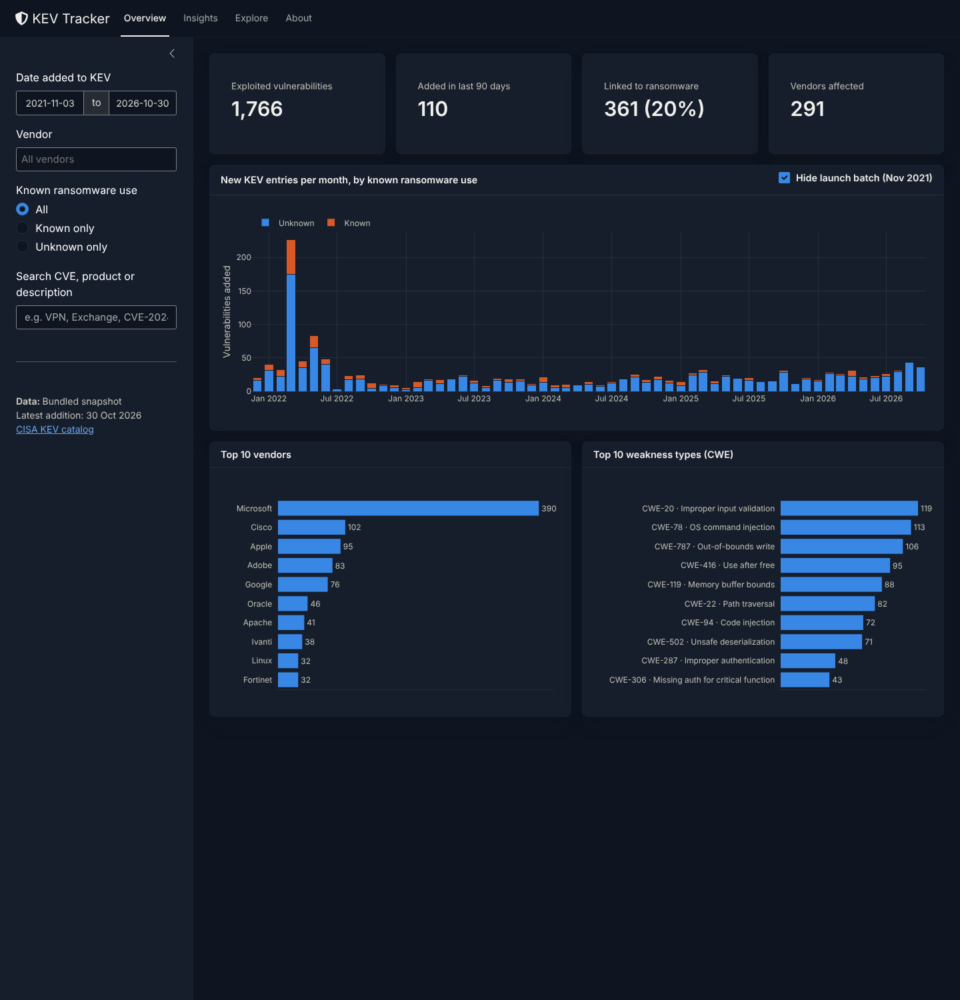
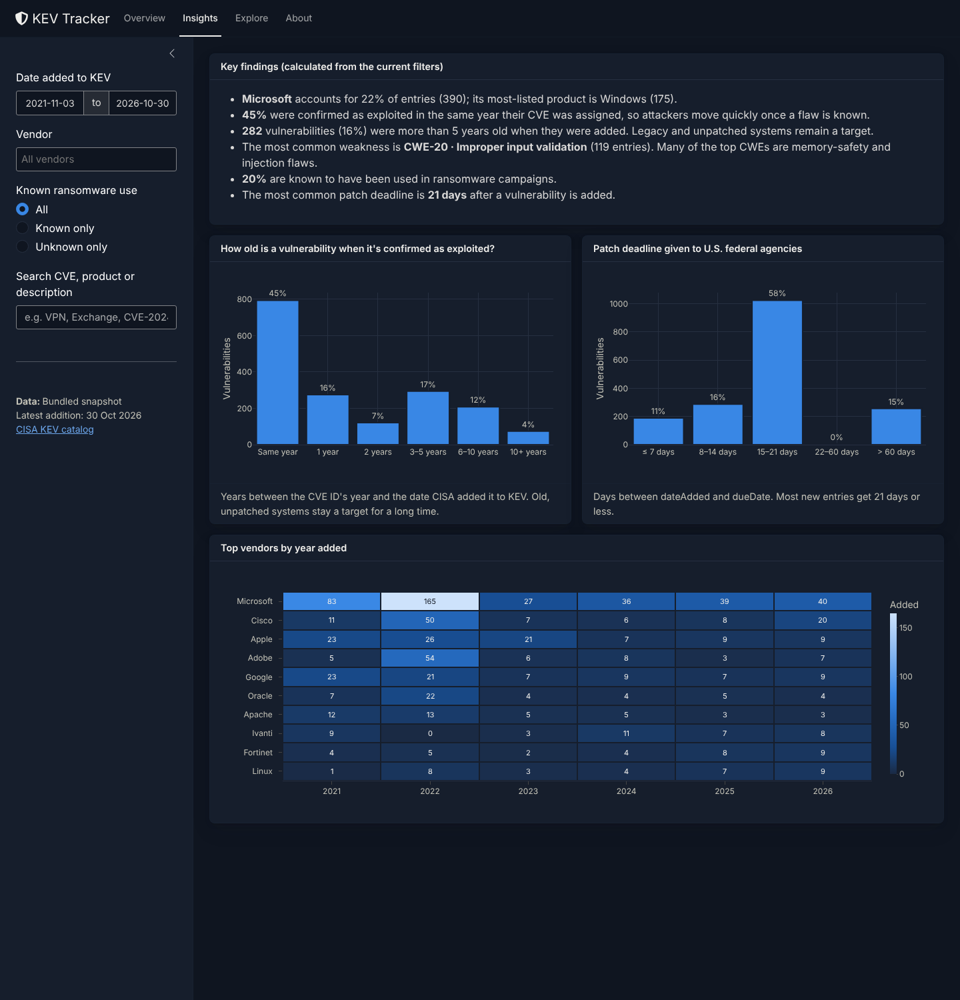

# 🛡️ KEV Tracker: Known Exploited Vulnerabilities Dashboard

An interactive R Shiny dashboard of **CISA's Known Exploited Vulnerabilities (KEV) catalog**, the official list of vulnerabilities confirmed to be exploited in real attacks. KEV is one of the most practical signals for vulnerability management: of the tens of thousands of CVEs published each year, these are the ones to patch first.

**Live app:** https://sqc2ym-pule-molise.shinyapps.io/kev-tracker-shiny/

Part of my cybersecurity portfolio: [project write-up](https://pulemolise.net/cybersecurity/kev-tracker/) · [pulemolise.net](https://pulemolise.net)



## What it shows

| Page | Contents |
|---|---|
| **Overview** | Headline numbers (total entries, added in the last 90 days, linked to ransomware, vendors); new entries per month split by ransomware use; top 10 vendors; top 10 weakness types (CWE) |
| **Insights** | Key findings generated from the current filters; how old vulnerabilities are when they're confirmed as exploited; how long agencies get to patch; vendor × year heatmap |
| **Explore** | Searchable table with links to each CVE on NVD, plus CSV download of the filtered data |
| **About** | Background, method notes and caveats |

The sidebar filters (date range, vendor, ransomware use, free-text search) apply to every page.



## Key findings (snapshot to 30 Oct 2026, 1,766 entries)

- **Microsoft accounts for 22%** of all entries (390). Windows alone has 175.
- **45% were confirmed as exploited in the same year their CVE was assigned.** Attackers move quickly once a flaw is public.
- **16% were more than 5 years old** when they were added. Legacy, unpatched systems stay a target for a long time.
- **20% are known to have been used in ransomware campaigns.**
- The most common weakness types are **input validation (CWE-20), OS command injection (CWE-78) and memory-safety bugs** (out-of-bounds write, use after free).
- The standard patch deadline is **21 days**, and 58% of entries fall in the 15–21 day window.

## Data

- Source: [CISA KEV catalog](https://www.cisa.gov/known-exploited-vulnerabilities-catalog), CSV feed.
- On start-up the app **tries to download the live feed** and falls back to the snapshot in `data/` if that fails. The sidebar shows which source is in use. To refresh the snapshot, replace `data/known_exploited_vulnerabilities.csv`.
- Derived fields: *age at listing* (year added minus the year in the CVE ID) and *patch window* (`dueDate − dateAdded`).

## Run locally

```r
install.packages(c("shiny", "bslib", "dplyr", "tidyr", "stringr", "readr", "plotly", "DT"))
shiny::runApp()   # from the repository folder
```

## Deploy to shinyapps.io

```r
install.packages("rsconnect")
rsconnect::setAccountInfo(name = "<account>", token = "<token>", secret = "<secret>")  # from shinyapps.io → Account → Tokens
rsconnect::deployApp(".", appName = "kev-tracker-shiny")
```

## Design notes

- Dark theme with a colour-blind-safe palette (blue for unknown ransomware use, orange for known), checked for contrast against the card background.
- The catalog's November 2021 launch batch (about 290 entries in one month) is hidden by default so it doesn't flatten the monthly trend.
- Every chart has hover tooltips, and every filter combination (including no results) is handled.

*Built with R · Shiny · bslib · plotly · DT · dplyr.*
